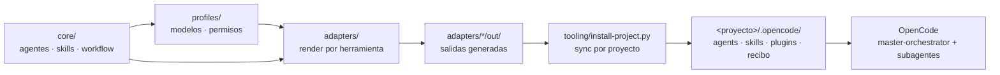
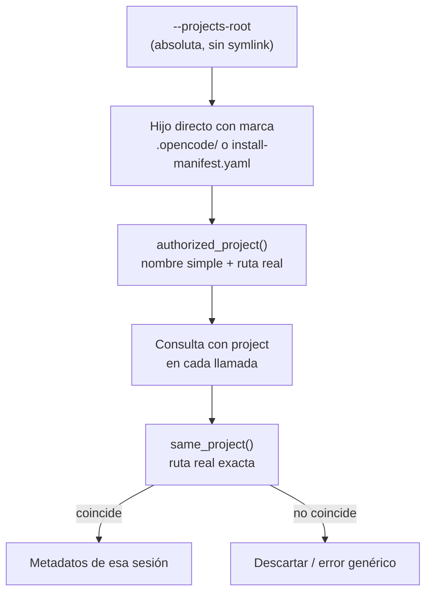
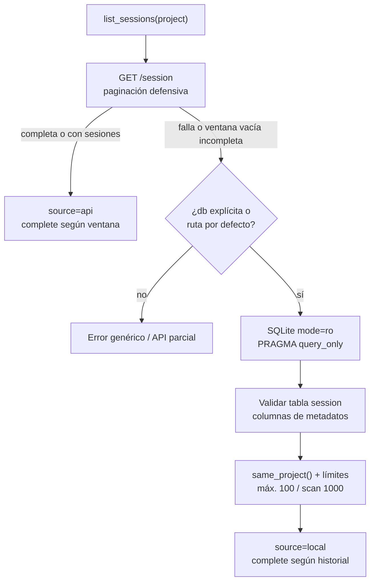
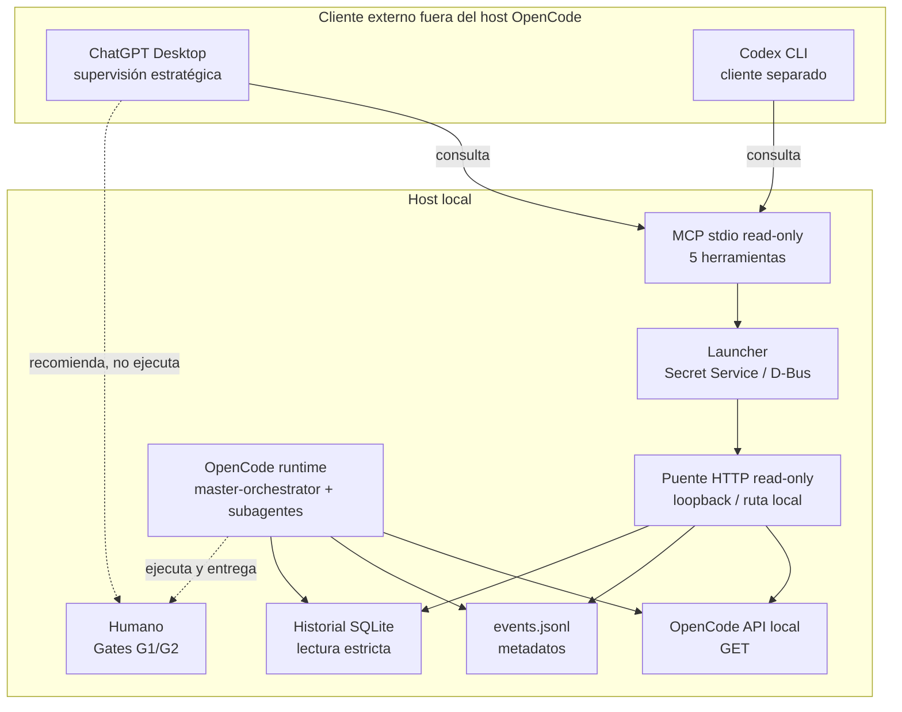
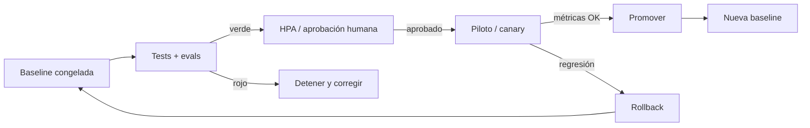
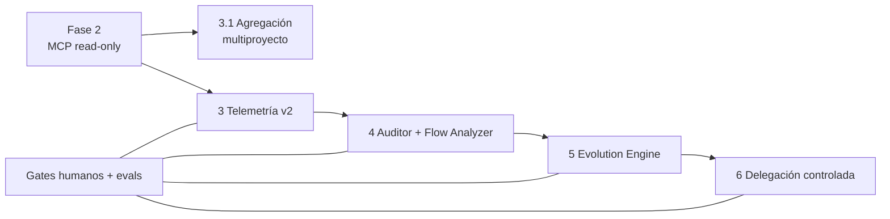

# Arquitectura de Agent Foundry

Documento canónico de arquitectura de Agent Foundry: estado verificado en el
repositorio, integración ChatGPT Desktop/Codex–OpenCode por fases, MCP local de
lectura y hoja de ruta de supervisión estratégica.

- **Snapshot de referencia:** `a865eb0` (`main`), más los cambios locales del
  working tree descritos en §3 y §4. No se presenta como integrado lo que solo
  existe localmente.
- **Fecha de esta revisión:** 2026-11-01.
- **Alcance:** documentación. Este documento no cambia runtime, perfiles,
  permisos, prompts ni configuración.
- **Autoridad:** ante contradicción mandan `profiles/*.yaml` para modelos y
  permisos, `core/workflow/states.md` para estados y gates, y el código/tests
  actuales para el comportamiento implementado. El README, los runbooks y este
  documento son prosa derivada; no sustituyen a esas fuentes.

## 1. Cómo leer este documento

### 1.1 Clasificación de estado

Cada afirmación relevante usa una de estas etiquetas:

| Etiqueta | Significado | Qué la respalda |
|---|---|---|
| **Implementado y verificado** | Existe en el repositorio y fue ejecutado o comprobado con evidencia local. | Código, tests, runbook de resultados, build/evals registrados. |
| **Implementado, pendiente de integración/revisión** | Existe en el working tree o en un commit reciente, pero no está integrado, revisado o verificado end-to-end en esta revisión. | Diff local, archivos nuevos, tests presentes pero no ejecutados aquí. |
| **Propuesto** | Diseño u objetivo declarado; no implementado. | Petición del usuario, este documento, roadmap. |
| **Histórico** | Evidencia de una ejecución pasada; no garantiza el estado actual. | Runbook fechado, informe de resultados. |

No se usa “verificado” para una afirmación que solo aparece en prosa. Tampoco se
usa “implementado” para una propuesta de control plane o de roadmap.

### 1.2 Fuentes de verdad y artefactos derivados

| Fuente | Rol | No editar a mano |
|---|---|---|
| `core/` | Agentes, skills y workflow agnósticos de modelo/proveedor. | Sí: se edita la fuente, no `adapters/*/out/`. |
| `profiles/models.yaml`, `profiles/permissions.yaml` | Únicos bindings de modelo, temperatura y permisos. | Sí: son la autoridad. |
| `core/workflow/states.md`, `core/workflow/matrix.yaml` | Enum de estados, gates y carriles. | Sí: fuente única del proceso. |
| `adapters/*/render.py` → `adapters/*/out/` | Salidas generadas por herramienta. | Sí: se regeneran con `tooling/build.sh`. |
| `install-manifest.yaml` + `tooling/install-project.py` | Instalación determinista por proyecto con recibo y backups. | El manifiesto se edita; el recibo es evidencia. |
| `README.md` (bloque `BEGIN/END:GENERATED-TABLES`) | Tablas derivadas de `core/` y `profiles/`. | Sí: lo genera `tooling/gen-readme.py`. |
| `docs/runbooks/*.md` | Procedimientos operativos. | Prosa con autoridad por tema, no sobre `profiles/`. |
| `docs/investigations/*.md` | Investigación previa. | No es norma ni runbook. |
| `docs/architecture.md`, `docs/adr/` | Arquitectura canónica y decisiones registradas. | Se actualizan por cambio material. |

El flujo de datos es:



### 1.3 Evidencia aportada por el usuario frente a evidencia reproducible

La petición que origina este documento aporta el objetivo de documentar el
as-built y el roadmap, la separación entre ChatGPT Desktop y Codex CLI, el
objetivo de un MCP local multiproyecto, el diseño del control plane y la
instrucción de conservar `master-orchestrator`. Esos puntos se registran como
**petición/propuesta**, no como hallazgo del repositorio.

Lo reproducible en este workspace se limita a lo que puede leerse y comprobarse
sin credenciales ni servicios externos:

- Estructura actual: 27 agentes en `core/agents/`, 75 `SKILL.md` en
  `core/skills/`, 23 suites en `evals/cases/`, manifiesto de instalación y
  plugins locales.
- Código y tests del puente, MCP y launcher.
- Runbooks fechados de las fases 1, 1.5 y 2.
- Recibo de instalación local `.opencode/foundry-install.json` (no se publica
  su contenido; solo se usa como evidencia de que existe instalación local).

No es reproducible aquí, sin una sesión gráfica con llavero, un servidor
OpenCode autenticado y un cliente Desktop conectado: una llamada real desde
ChatGPT Desktop, una ejecución real de Codex CLI contra este MCP, o una
respuesta de modelo a través del puente. Los detalles de resultados de esos
clientes que no estén en los runbooks se marcan como **aportados/no
reproducibles**.

## 2. Arquitectura as-built

### 2.1 Principio de diseño

`core/` no menciona modelos concretos ni rutas absolutas. Los bindings viven
solo en `profiles/`; los adapters generan la configuración nativa de cada
herramienta. Cambiar un modelo o migrar de herramienta es editar un YAML y
reconstruir; nunca parchear `adapters/*/out/`
[AGENTS.md:9-12,16-26; PLAN.md:6-20].

### 2.2 Agentes, skills y workflow

- **Agentes:** 27 archivos en `core/agents/sdlc/` (workers, consultants,
  validators y guardrails). El adapter OpenCode filtra por
  `harness.primary|active_subagents|optional_subagents` de
  `profiles/permissions.yaml`; `harness.excluded` deja fuera de OpenCode a
  `general`, `architect-executor`, `requirements-analyst` y `refactor`. El
  resultado son 23 agentes en `adapters/opencode/out/agents/`
  (`find core/agents -name '*.md' | wc -l` = 27;
  `find adapters/opencode/out/agents -name '*.md' | wc -l` = 23).
- **Skills:** 75 `SKILL.md` bajo `core/skills/`. El directorio
  `core/skills/jev-routing/` existe vacío en el working tree; no cuenta como
  skill (resto huérfano del inventario del pack, no se restaura aquí).
- **Workflow:** `core/workflow/states.md` define el enum canónico y los gates
  G1/G2. Los carriles `trivial`, `fix`, `feature` y `workspace` comparten el
  enum; `trivial` y `fix` son ODD y no pasan por planning/Gate 1, pero `fix`
  exige reviewer y Gate 2 [core/workflow/states.md:1-60,162-164;
  core/workflow/matrix.yaml:289-311].
- **Evidencia de comportamiento:** 23 suites en `evals/cases/`. El runner
  ejecuta en sandbox temporal y solo evalúa respuestas de texto; un timeout o
  una salida ausente no es PASS [docs/runbooks/evals.md:30-66].

### 2.3 Instalación por proyecto

Los agentes, skills y plugins viven en el proyecto destino, no en una
configuración global. `install-manifest.yaml` declara agentes, skills, tres
plugins (`model-router`, `permission-guardian`, `agent-observer`), directorios y
la fusión de `default_agent: master-orchestrator`
[install-manifest.yaml:8-35]. `tooling/install-project.py --apply` preserva
claves ajenas de `opencode.json`, guarda backup y escribe un recibo
`foundry/install/v1` en `.opencode/foundry-install.json`
[AGENTS.md:17-20,70-73; tooling/install-project.py:18,64-68,130-132].

Esto permite que un mismo repositorio Foundry instale bundles distintos en
proyectos distintos sin tocar la configuración global. El recibo es la base
para comparar baseline y rollback (§6).

### 2.4 Runtime OpenCode

- **Orquestador:** `master-orchestrator` es el agente primario y conserva el
  contexto y las delegaciones. No ejecuta cambios de código directamente
  [README.md:255; install-manifest.yaml:31-35].
- **Routing:** el plugin `model-router` aplica el modelo estático agente→modelo
  en el hook `chat.message`, porque `Task` no acepta `model` en sus args. La
  tabla `ROUTING` se genera desde `profiles/models.yaml`; no se hardcodea en
  `core/` ni en `plugins/` [docs/runbooks/model-router.md:6-19,30-38;
  AGENTS.md:23-26].
- **Permisos:** `profiles/permissions.yaml` define `edit`/`bash`/`task` por
  agente y `safe_shell`. El Permission Guardian del bundle rechaza
  subagentes ausentes y herramientas externas no habilitadas por
  `FOUNDRY_EXTERNAL_TOOLS`; no sustituye a los permisos nativos de OpenCode ni
  es un sandbox del sistema operativo
  [docs/runbooks/agent-operations.md:3-17;
  plugins/opencode/permission-guardian/permission-guardian.ts.tmpl:1-30].
- **Observación local:** `foundry-agent-observer.ts` escribe solo metadatos en
  `<proyecto>/.opencode/.foundry/events.jsonl` (0600): inicio/fin de tool y
  eventos de permiso o sesión. No guarda prompts, argumentos ni respuestas
  [plugins/opencode/agent-observer/agent-observer.ts:1-42;
  docs/runbooks/agent-operations.md:19-34].
- **Facturación:** la inferencia se reparte entre ChatGPT Plus (razonamiento
  escaso: Sol) y OpenCode Go Plus (volumen y puertas de calidad). Son
  suscripciones y contadores separados; `fallbacks` es config declarativa que
  ningún adapter consume [docs/runbooks/opencode-harness.md:16-56;
  PLAN.md:107-144].

### 2.5 Integración con ChatGPT Desktop y Codex CLI: estado actual

Hay que separar tres cosas:

1. **Cliente Desktop/Codex:** ChatGPT Desktop y Codex CLI son clientes
   externos. La petición los define como clientes distintos de la misma
   integración; no se asume que el adapter `adapters/chatgpt/out/` (asociado a
   Codex) describa el comportamiento de ambos.
2. **Puente local:** `tooling/opencode_bridge.py` consulta la API HTTP local de
   OpenCode en solo lectura, valida loopback/ruta local, rechaza redirecciones
   y proxies y filtra por proyecto. No escribe, no responde permisos y no
   inicia sesiones [tooling/opencode_bridge.py:1-5,20-61,485-552].
3. **MCP local:** `tooling/opencode_mcp.py` expone cinco herramientas de
   metadatos por stdio. Es el canal pensado para que un cliente Desktop
   consulte sin ejecutar [tooling/opencode_mcp.py:1-32].

**Estado:** la integración local está implementada y probada en el entorno de
prueba de la fase 1.5; **no hay evidencia en el repositorio de una llamada
exitosa desde ChatGPT Desktop ni de una ejecución de Codex CLI**. La fase 1.5
dice explícitamente que no se verificó una conexión directa entre OpenCode y la
conversación de ChatGPT referenciada, y la fase 2 dice que la verificación no
acredita una conexión real desde Desktop
[docs/runbooks/chatgpt-opencode-phase15-results.md:19;
docs/runbooks/chatgpt-opencode-phase2.md:156-169].

## 3. Integración ChatGPT–OpenCode: reconstrucción de fases

Esta sección reconstruye las fases con la evidencia disponible. No completa por
inferencia los resultados de Codex CLI/ChatGPT Desktop que no estén
documentados.

### 3.1 Fase 1 — observación

**Objetivo:** que ChatGPT Desktop consulte metadatos y audite evidencias sin
responder permisos, ejecutar tareas ni firmar gates; `master-orchestrator`
sigue siendo el orquestador en OpenCode
[docs/runbooks/chatgpt-opencode-phase1.md:1-6].

**Piezas:**

- Puente HTTP de solo lectura con `--project`, `--base-url`, `sessions`,
  `session`, `events` y `simulate`.
- Observador local de metadatos y Permission Guardian en el bundle.
- Skills desktop-only en `adapters/chatgpt/skills/` (no se instalan en
  OpenCode).
- Simulación de permisos con `read-candidate` y `escalate-to-human`; ambas
  mantienen `requires_real_approval: true` y no autorizan nada
  [docs/runbooks/chatgpt-opencode-phase1.md:29-44].

**Estado:** **implementado y verificado** en la prueba local de la fase 1.5
(48 pruebas unitarias, lint, auditoría de matriz 0 hallazgos y build; instalador
en proyecto temporal; API 1.18.31 autenticada en loopback; sesiones/eventos y
simulación) [docs/runbooks/chatgpt-opencode-phase15-results.md:7-11].

**Límites de la fase:** el resumen de eventos es parcial si el plugin no estuvo
instalado o falló; no hay resultado funcional, tokens ni costes por paso; la
clasificación de permisos no replica todas las reglas nativas y no autoriza
[docs/runbooks/chatgpt-opencode-phase1.md:23-27,38-44,46-55].

### 3.2 Fase 1.5 — prueba local

**Qué es:** un registro fechado (2026-11-01 UTC) de la prueba en Agent Foundry
y un proyecto temporal. No se instalaron componentes en proyectos corporativos
ni se cambió la política de permisos
[docs/runbooks/chatgpt-opencode-phase15-results.md:1-3].

**Resultados registrados (histórico):**

| Resultado | Evidencia | Lectura correcta |
|---|---|---|
| 48 pruebas unitarias, lint, matriz 0 y build pasaron. | phase15:7 | Verificación local reproducible en su momento; no re-ejecutada en esta tarea. |
| Instalador aplicó 112 archivos y `master-orchestrator` como primario; observer y Permission Guardian incluidos; sin permisos automáticos. | phase15:8 | Bundle instalado; no certifica calidad de ejecución. |
| OpenCode 1.18.31 con API autenticada en `127.0.0.1:4096`; acceso anónimo 401; `/doc` expuso OpenAPI 3.1; socket solo loopback y cerrado al terminar. | phase15:9 | Contrato de API comprobado en esa versión. |
| El puente devolvió `[]` inicialmente; una sesión de prueba con `master-orchestrator` fue leída; `events`/`observe.py` registraron `session.error` y `session.idle`; archivo 0600. | phase15:10 | Evidencia de conexión y observer, **no** de ejecución satisfactoria del modelo. |
| La simulación clasificó lectura interna como `read-candidate` y escritura como `escalate-to-human`; `mode: simulation`, `requires_real_approval: true`. | phase15:11 | Clasificación no vinculante. |

**Bloqueos registrados (histórico):**

- Las cuatro skills nuevas no pudieron copiarse a `~/.codex/skills` por
  `Read-only file system`; las tres ya presentes coincidían con las salidas
  generadas. Las cuatro nuevas quedaron preparadas en
  `adapters/chatgpt/out/skills/` [phase15:15].
- El lanzador habitual intentó instalar OpenCode 2.1.2 con `mise` y falló por
  sistema de solo lectura; el binario 2.1.2 existente devolvió HTML en
  `/global/health`, `/doc` y `/session`, incompatible con el contrato del
  puente. La prueba usó el binario 1.18.31 ya instalado [phase15:16].
- La generación no produjo respuesta: `ProviderModelNotFoundError` para
  `openai/gpt-6-luna`; `/provider` solo informó `opencode`
  [phase15:17].
- Un listener preexistente en otra dirección/puerto no se identificó ni
  modificó; la prueba no acredita su estado de exposición [phase15:18].
- No se verificó conexión directa entre OpenCode y la conversación de ChatGPT;
  solo la consulta local del puente [phase15:19].

**Estado:** **histórico**. Es evidencia de una ejecución pasada, no una
garantía del estado actual ni una certificación de ChatGPT Desktop.

### 3.3 Fase 2 — MCP local de lectura

**Objetivo:** servir metadatos de varios proyectos por stdio, con la raíz fijada
al arrancar (`--projects-root`) y el proyecto indicado en **cada** consulta
[docs/runbooks/chatgpt-opencode-phase2.md:3-14].

**Piezas:** `tooling/opencode_mcp.py`, cinco herramientas read-only, alcance por
proyecto, `same_project()` y verificación de sesión; el puente conserva el
transporte HTTP, Basic auth, rechazo de proxies/redirecciones y destino local
[phase2:16-40; tooling/opencode_mcp.py:18-32,39-93].

**Estado:** **implementado** en el commit `a865eb0` (`feat(tooling): soporte
multiproyecto en opencode_mcp y opencode_bridge`), con tests unitarios en
`tooling/tests/test_opencode_mcp.py` y `test_opencode_bridge.py`. La conexión
real desde ChatGPT Desktop **no está acreditada**; el propio runbook lo declara
[phase2:156-169]. Los tests no se ejecutaron en esta tarea documental.

**Alcance multiproyecto:** es un objetivo y una implementación por consulta;
la operación simultánea de varios clientes/proyectos bajo carga no está
demostrada. Se documenta como **implementado, pendiente de verificación de
concurrencia e integración**.

### 3.4 Fase 2.1 — launcher con Secret Service

> **Nota de reconstrucción:** el runbook no rotula una sección “Fase 2.1”. La
> denominación se usa aquí para la pieza intermedia entre el MCP base (fase 2)
> y la recuperación SQLite (fase 2.2, sí rotulada): el launcher que obtiene la
> credencial de Secret Service. Si el usuario dio a “2.1” otro contenido, este
> documento no lo afirma.

**Objetivo:** que el MCP nunca reciba el secreto por argumentos, URL,
repositorio ni configuración. `tooling/opencode_mcp_launch.py` recupera
usuario/contraseña con `secret-tool` y se reemplaza por
`tooling/opencode_mcp.py` mediante `os.execve`, conservando `--projects-root` y
`--base-url` [docs/runbooks/chatgpt-opencode-phase2.md:42-53;
tooling/opencode_mcp_launch.py:1-16,101-132].

**Propiedades de seguridad implementadas:**

- Solo viaja en el entorno del proceso ejecutado; el launcher no lo imprime ni
  lo registra.
- Reconstruye el entorno desde una lista mínima (`PATH`, `LANG`, `LC_ALL`,
  `LC_MESSAGES`), elimina proxies y sobreescrituras del intérprete.
- Falla cerrado si el llavero está bloqueado, falta `secret-tool` o no hay
  contraseña; mensajes genéricos.
- Usuario opcional (`opencode` por defecto); contraseña obligatoria.
  [tooling/opencode_mcp_launch.py:28-38,45-98,118-132]

**D-Bus:** en Linux, `secret-tool` necesita el bus de sesión. El cliente Desktop
debe reenviar `DBUS_SESSION_BUS_ADDRESS` y `XDG_RUNTIME_DIR`; no contienen la
contraseña. En la comprobación del 2026-11-01, un entorno mínimo sin D-Bus
produjo `Error: No se pudo obtener la credencial`; con esas variables recuperó
la credencial e inició el MCP [phase2:92-98].

**Estado:** **implementado, pendiente de integración/revisión**. El archivo
`tooling/opencode_mcp_launch.py` y su test
`tooling/tests/test_opencode_mcp_launch.py` están sin trackear en el working
tree; el runbook de fase 2 tiene la sección correspondiente como cambio local
no committeado. No se ejecutaron los tests en esta tarea.

**Limitación detectada:** el launcher reenvía solo `--projects-root` y
`--base-url`; **no** reenvía `--opencode-db`. Si se usa el launcher, el respaldo
SQLite solo puede autodetectar la ruta por defecto
(`~/.local/share/opencode/opencode.db`). Para una ruta explícita hay que usar el
servidor directo con el entorno ya provisto
[tooling/opencode_mcp_launch.py:131-132; tooling/opencode_mcp.py:100-117;
tooling/opencode_bridge.py:245-253].

### 3.5 Fase 2.2 — ventana truncada y respaldo SQLite

**Problema:** en OpenCode 1.18.31, `GET /session` se documenta como lista total
sin parámetros; no hay filtro `directory` ni paginación oficiales y no se asume
la API v2. Sondas sin credencial a `/session`, `?directory=…` y
`?limit=…&offset=…` devuelven 401: la auth precede al filtro, así que el soporte
de parámetros no es verificable sin secreto y el código no depende de él
[docs/runbooks/chatgpt-opencode-phase2.md:119-129].

**Comportamiento implementado:**

- La lectura API usa `GET /session` y, de forma defensiva, prueba
  `?limit=&offset=` solo con enteros; si la página se repite o el parámetro se
  rechaza, degrada a una sola lectura marcada como posiblemente truncada
  [tooling/opencode_bridge.py:136-173].
- `list_sessions` devuelve `{sessions, complete, source, note?}`. Una ventana
  truncada produce `complete: false`; vacío+incompleto lleva la nota
  “ventana incompleta; cero sesiones no concluyente”
  [tooling/opencode_bridge.py:199-213,342-374].
- Ante API caída o ventana vacía incompleta, respaldo en el historial SQLite
  local en lectura estricta (`mode=ro` + `PRAGMA query_only=ON`, sin escritura
  ni bloqueo): valida esquema (`session` con `id`, `directory`,
  `time_created`, `time_updated`), lee solo esas columnas —nunca títulos,
  mensajes, partes ni metadatos—, respeta `same_project()`, IDs, límites (máx.
  100 resultados, exploración máx. 1000) y errores genéricos sin rutas
  [tooling/opencode_bridge.py:256-339].
- CLI: `sessions [--limit 1-100] [--db RUTA] [--local]`; `--local` consulta
  solo historial. MCP: `--opencode-db` opcional; sin él se autodetecta
  `~/.local/share/opencode/opencode.db` si es utilizable
  [tooling/opencode_bridge.py:485-552; tooling/opencode_mcp.py:96-117].

**Evidencia del diagnóstico:** el runbook registra que la ventana API devolvía
100 filas ajenas mientras el historial local tenía muchas más sesiones del
proyecto; el `[]` anterior era filtro correcto sobre ventana truncada, no
ausencia de historial. No se reproducen aquí nombres de proyectos ni contenido
[docs/runbooks/chatgpt-opencode-phase2.md:150-154].

**Estado:** **implementado, pendiente de integración/revisión**. Los cambios en
`tooling/opencode_bridge.py`, `tooling/opencode_mcp.py`, sus tests y el runbook
de fase 2 están en el working tree. No se ejecutaron tests ni se consultó el
`.db` real en esta tarea.

### 3.6 Estado consolidado de fases

| Fase | Estado | Evidencia | Límite |
|---|---|---|---|
| 1 — observación | Implementado y verificado en prueba local | Puente, observer, simulación; phase1/phase15 | No acredita Desktop real ni calidad de modelo. |
| 1.5 — prueba local | Histórico | phase15 fechado 2026-11-01 | No re-ejecutada; entorno y credenciales no disponibles. |
| 2 — MCP base multiproyecto | Implementado (HEAD `a865eb0`) | `opencode_mcp.py`, tests, phase2 | Conexión Desktop no acreditada; concurrencia no demostrada. |
| 2.1 — launcher Secret Service | Implementado local, pendiente de integración/revisión | `opencode_mcp_launch.py` (untracked), test, sección local de phase2 | No commit; tests no ejecutados; D-Bus requerido. |
| 2.2 — SQLite/ventana truncada | Implementado local, pendiente de integración/revisión | Diff en bridge/mcp/tests/phase2 | No commit; tests no ejecutados; `.db` no inspeccionado. |
| Control plane / fases 3+ | Propuesto | §5–§7 | No implementado. |

### 3.7 Evidencia aportada frente a reproducible: resumen

| Afirmación | Clasificación | Dónde consta |
|---|---|---|
| ChatGPT Desktop consulta metadatos y no orquesta. | Decisión documentada; implementación local parcial. | phase1:1-6; ADR-0001. |
| Hay un MCP local multiproyecto de cinco herramientas. | Implementado en HEAD; conexión Desktop no acreditada. | phase2:16-40; `opencode_mcp.py`. |
| El MCP usa launcher con Secret Service y D-Bus. | Implementado local, pendiente de integración. | `opencode_mcp_launch.py`; phase2:42-98. |
| El respaldo SQLite recupera sesiones cuando la ventana API es incompleta. | Implementado local, pendiente de integración. | `opencode_bridge.py:342-374`; phase2:119-154. |
| Codex CLI/ChatGPT Desktop obtuvieron resultados concretos de ejecución. | **Aportado/no reproducible**: no hay evidencia en el repo de una llamada exitosa; phase15 solo registra fallos de copia de skills, CLI 2.1.2 incompatible, `ProviderModelNotFoundError` y ausencia de conexión directa verificada. | phase15:15-19; phase2:156-169. |
| Existe un control plane de supervisión estratégica. | **Propuesto**, no implementado. | §5; petición del usuario. |

## 4. MCP local de lectura

### 4.1 Transporte y alcance

- **Transporte:** stdio, un proceso por cliente; la raíz de proyectos se fija
  al arrancar con `--projects-root` y debe ser absoluta, no symlink y existente
  [tooling/opencode_mcp.py:96-117].
- **Alcance:** cada consulta indica `project`; no hay selección global
  persistente [phase2:3-5].
- **Solo lectura:** el servidor usa `GET` contra OpenCode y lectura del registro
  local/SQLite. No crea sesiones, no responde permisos, no escribe en
  proyectos [phase2:33-40; `opencode_mcp.py:1-14`].

### 4.2 Las cinco herramientas

| Herramienta | Entrada | Salida | Límite |
|---|---|---|---|
| `list_projects` | ninguna | Hasta 100 objetos `{project}` de hijos directos elegibles | Solo directorios con `.opencode/` o `install-manifest.yaml`; sin symlinks ni anidados. |
| `list_sessions` | `project` | `{sessions: [{id, parent_id, created, updated}], complete, source, note?}` | Máx. 100; `complete=false` ⇒ ventana parcial; vacío+incompleto no es concluyente. |
| `get_session_status` | `project`, `session_id` | `{session_id, status}` con `idle`, `busy`, `retry` o `null` | Exige verificar primero el directorio de la sesión. |
| `get_session_events` | `project`, `session_id`, `limit?` | Hasta `limit` eventos de metadatos del JSONL local | Máx. 100; ausencia de eventos no prueba que no ocurrió una acción. |
| `get_session_messages` | `project`, `session_id`, `limit?` | Hasta `limit` metadatos de mensajes | Máx. 100; por defecto 50; nunca texto, prompts, argumentos ni resultados. |

Fuente: `tooling/opencode_mcp.py:18-32,54-90`; esquemas con
`additionalProperties: false`, `project` con regex de nombre simple, `session_id`
con regex y `limit` entero 1-100. El runbook resume `list_projects` como
“nombres”; el código devuelve objetos `{project}`. Se documenta el código.

### 4.3 Aislamiento de proyecto

`authorized_project()` exige:

1. nombre de proyecto como segmento simple (regex, sin `.`/`..`);
2. raíz absoluta, no symlink, existente y directorio;
3. hijo directo real, no symlink, cuyo padre real sea la raíz;
4. marca `.opencode/` (directorio) o `install-manifest.yaml` (archivo), no
   symlink.

`same_project()` exige ruta absoluta, sin `..`, no symlink, y que la ruta real
resuelta sea exactamente el proyecto y su padre real sea el padre del proyecto.
Las sesiones ajenas se descartan; los errores no incluyen rutas ni fragmentos
[opencode_bridge.py:74-117].

Esto es autorización de descubrimiento y de consulta, no un sandbox del sistema
operativo: el proceso corre con el usuario del host y el aislamiento depende de
estas comprobaciones y de los permisos del filesystem.



### 4.4 Autenticaciones separadas

No son intercambiables; confundirlas es la causa más común de fallo:

| Autenticación | Qué protege | Dónde vive | Quién la aporta |
|---|---|---|---|
| **OpenCode Go** (proveedor) | Modelos de inferencia del harness OpenCode. | Sesión de OpenCode (`/connect`). | Usuario, una vez por host/suscripción. |
| **ChatGPT/OpenAI** (Desktop/Codex) | Cuenta del cliente externo que consulta el MCP. | Cliente Desktop/Codex. | Usuario del cliente. |
| **API HTTP local de OpenCode** | `GET` a `127.0.0.1:4096` o ruta local por `lo`. | `OPENCODE_SERVER_PASSWORD` + usuario opcional `opencode`, en el entorno del proceso. | Launcher vía Secret Service; o entorno ya provisto en desarrollo. |
| **Secret Service / D-Bus** | Entrega de la credencial de la API local al launcher. | Llavero de la sesión gráfica. | Usuario; `secret-tool` la consulta. |
| **MCPs de agentes** (AWS, GitHub, Context7…) | Servicios externos de los agentes en OpenCode. | Configuración de OpenCode. | OAuth/perfil correspondiente; ajeno a este puente. |

Reglas:

- El secreto de la API local **nunca** va en argumentos, URL, repositorio,
  configuración de Desktop ni logs; solo en el entorno del proceso ejecutado
  [phase2:42-53].
- `OPENCODE_SERVER_USERNAME` es opcional; por defecto `opencode`.
- La contraseña de OpenCode Go no es la contraseña de la API local. La cuenta
  de ChatGPT no autentica la API local. El MCP no usa ninguna de las dos para
  inferencia: solo lee metadatos.
- El servidor valida que la dirección sea loopback o una IP literal que el
  kernel enrute localmente por `lo`; no acepta proxies ni redirecciones
  [opencode_bridge.py:20-61].

### 4.5 Launcher, Secret Service y D-Bus

Provisión inicial (una vez por host; `store` pide el valor por terminal y no lo
deja en el historial de argumentos):

```bash
secret-tool store --label='agent-foundry OpenCode username' app agent-foundry-opencode field username
secret-tool store --label='agent-foundry OpenCode password' app agent-foundry-opencode field password
```

Rotación: repetir el `store`. Revocación:
`secret-tool clear app agent-foundry-opencode field password` (y `username` si
aplica). No exportar los valores en shell ni copiarlos a archivos
[phase2:55-70].

Comportamiento del launcher:

- `secret-tool lookup app agent-foundry-opencode field username` → si no existe,
  usa `opencode`.
- `... field password` → obligatoria; si falta o el llavero está bloqueado,
  falla con mensaje genérico y no inicia el servidor.
- timeout de 10 s por consulta; errores de `secret-tool` no se propagan.
- entorno hijo: `PATH`, `LANG`, `LC_ALL`, `LC_MESSAGES` +
  `OPENCODE_SERVER_USERNAME` + `OPENCODE_SERVER_PASSWORD`; sin proxies ni
  overrides del intérprete.
- `os.execve(python, [python, opencode_mcp.py, --projects-root, root,
  --base-url, args.base_url], env)`.
  [tooling/opencode_mcp_launch.py:28-38,45-98,118-132]

D-Bus: el cliente Desktop debe reenviar `DBUS_SESSION_BUS_ADDRESS` y
`XDG_RUNTIME_DIR` para que el proceso hijo alcance el bus de sesión y el
llavero. Si el cliente arranca en un entorno mínimo, el launcher falla antes de
responder a `initialize`. El runbook registra el diagnóstico y el reenvío que
funcionó [phase2:92-98,100-112].

### 4.6 Respaldo SQLite y semántica `complete`/`source`



- `source` es `api` o `local`; `complete=false` significa ventana/historial
  parcial. Nunca se interpreta un vacío incompleto como “no hubo sesiones”
  [opencode_bridge.py:199-213,335-374].
- La lectura SQLite es estricta: `mode=ro` + `query_only=ON`, sin escritura ni
  bloqueo; solo `id`, `parent_id` (si existe), `directory`, `time_created`,
  `time_updated`; nunca títulos, mensajes, partes ni metadatos de contenido
  [opencode_bridge.py:256-339].
- La ruta por defecto es `~/.local/share/opencode/opencode.db`; si es symlink o
  no es archivo, no se usa. `--opencode-db` permite una ruta explícita al
  servidor directo. El launcher no la reenvía (§3.4).
- El esquema SQLite es un contrato externo de OpenCode: si cambia, el respaldo
  falla cerrado con error genérico.

### 4.7 Límites explícitos

1. **No hay observabilidad en vivo.** No se consume `/event` ni un stream de
   larga duración. Los eventos se leen bajo demanda desde
   `.opencode/.foundry/events.jsonl`; el resumen es parcial y la ausencia de un
   evento no prueba que un paso no ocurrió
   [phase1:46-55; agent-operations.md:19-34].
2. **No hay ejecución remota.** El MCP no inicia sesiones, no envía prompts, no
   ejecuta agentes, no responde permisos y no escribe archivos. La ejecución
   sigue en OpenCode y `master-orchestrator` conserva la orquestación
   [phase2:33-40; phase1:1-6].
3. **No hay operaciones de escritura.** Solo `GET` a OpenCode y lectura local;
   no `POST`, `PATCH` ni `DELETE` [opencode_bridge.py:1-5,47-61].
4. **No hay conclusión por vacío.** `complete=false` y notas parciales impiden
   tratar una lista vacía como ausencia de actividad [phase2:21-24].
5. **No hay acreditación de Desktop.** La conexión real desde ChatGPT
   Desktop/Codex CLI no está verificada en el repositorio
   [phase2:156-169].
6. **No hay garantía de concurrencia multiproyecto.** El alcance por consulta
   está implementado; la operación simultánea bajo carga no se ha demostrado.
7. **No hay tokens, costes ni resultado funcional.** El contrato de eventos
   actual no los incluye; una auditoría de cumplimiento necesita contrastar
   artefactos y pruebas [agent-operations.md:31-34].

## 5. Supervisión estratégica futura (propuesta)

> **Estado:** propuesta. No implementada. No sustituye a `master-orchestrator`,
> no concede permisos y no firma gates. La petición del usuario define los
> componentes y las dimensiones a documentar; los detalles no aportados se
> marcan como “por definir”.

### 5.1 Principio: supervisar, no orquestar

`master-orchestrator` sigue siendo el orquestador vigente en OpenCode. ChatGPT
Desktop se sitúa **por encima** como supervisora estratégica externa:

- **Observa** metadatos y evidencias.
- **Audita** correlaciones y lagunas.
- **Analiza** flujo, costes, bloqueos y calidad.
- **Recomienda** cambios y experimentos.
- **No ejecuta** agentes, no responde permisos, no escribe en proyectos y no
  firma Gate 1/Gate 2.

La autoridad humana y los gates del workflow siguen intactos. Una recomendación
de la supervisora no es una aprobación.

### 5.2 Capas



### 5.3 Componentes del control plane

| Componente | Función | Entradas | Salidas | Dueño | Estado |
|---|---|---|---|---|---|
| **Observability Collector** | Recolecta y normaliza metadatos de sesiones, eventos e historial, preservando `source`/`complete`. | MCP read-only, `events.jsonl`, SQLite, recibo de instalación. | Snapshots de telemetría con marcas de integridad. | Foundry (servidor/observer) + Desktop (consulta). | Base: observer + MCP (fases 1–2); colector unificado propuesto. |
| **Execution Auditor** | Correlaciona sesiones, eventos, tool calls y artefactos/recibos; detecta huecos y separa observado de inferido. | Snapshots, recibos, artefactos del incremento. | Informe de auditoría no vinculante. | Desktop (rol auditor) con evidencia del usuario. | Skill `execution-auditor` existe; motor de correlación propuesto. |
| **Flow Analyzer** | Analiza fases, handoffs, bloqueos, reintentos y latencia de gates. | Snapshots, specs/board, informes. | Análisis de flujo y recomendaciones priorizadas. | Desktop. | Propuesto. |
| **Permission Guardian (simulación)** | Clasifica solicitudes (`read-candidate` / `escalate-to-human`); nunca concede. | JSON local `{action, resources}`. | Recomendación con `requires_real_approval: true`. | Foundry (puente) + Desktop (skill). | Simulación implementada; sin autoridad real. |
| **Evolution Engine** | Propone y prueba cambios versionados de prompts, modelos o políticas. | Baseline, evals, métricas, informes. | Candidato versionado + informe de experimento. | Humano + Foundry. | Propuesto. |
| **Knowledge management** | Índice de fuentes canónicas, decisiones, evidencias y memorias redactadas. | `docs/architecture.md`, ADRs, runbooks, informes. | Knowledge pack con vigencia y autoridad. | Foundry (documentation). | Parcial: arquitectura, ADRs y runbooks existen; automatización propuesta. |

### 5.4 Inputs, outputs, ownership, trust y privacy

**Inputs permitidos hoy:** IDs de sesión, tiempos, agente, nombres de
herramientas, tipos de evento, estado, `source`, `complete`, recibos y
artefactos que el usuario decida compartir.

**Inputs prohibidos o condicionados:** prompts, argumentos, respuestas,
resultados de herramientas, títulos, rutas de proyectos, secretos, datos
personales o corporativos, capturas con información sensible. El contrato
actual ya excluye esos campos del MCP y del observer; la supervisora no debe
intentar obtenerlos por otras vías.

**Outputs:** informes de observación/auditoría, análisis de flujo,
recomendaciones, propuestas de experimento y knowledge packs. Todos deben
indicar fuentes, fecha, baseline, cobertura y límites; ninguno es una firma de
gate.

**Ownership:**

- Foundry mantiene el observer, el puente, el MCP, el esquema de eventos y la
  documentación canónica.
- El usuario/equipo mantiene la configuración del cliente Desktop, las
  credenciales y las decisiones de política.
- El humano mantiene la aprobación de gates, cambios de modelo/perfil y
  cualquier acción con efectos.
- Ningún componente se autoaprueba ni se autoconcede permisos.

**Trust:**

- Los logs, transcripciones y salidas de modelos son **datos no confiables**:
  pueden contener instrucciones maliciosas (prompt injection).
- Los metadatos son evidencia con lagunas; la ausencia de evento no prueba
  ausencia de acción.
- Una recomendación de Permission Guardian o de un auditor es asesoría, no
  autorización.
- La autoridad final es el workflow (`states.md`), los permisos nativos de
  OpenCode y la firma humana.

**Privacy:**

- Minimización: solo metadatos; no contenido.
- Redacción: placeholders para rutas, IDs, nombres y cualquier dato de cliente.
- Retención: por defecto efímera; no persistir logs crudos en el repositorio;
  si hace falta evidencia, guardar hashes o resúmenes redactados.
- Aislamiento: consultas por proyecto; no mezclar proyectos en un informe.
- No enviar a un modelo externo datos que no estén explícitamente permitidos.

### 5.5 Métricas

| Métrica | Definición | Fuente actual | Estado |
|---|---|---|---|
| Cobertura de eventos | Sesiones con al menos un evento / sesiones observadas. | `events.jsonl` + `list_sessions`. | Parcial; no agregada. |
| Completitud de ventana | `list_sessions.complete=true` / total de consultas. | Campo `complete`. | Disponible por consulta; sin serie histórica. |
| Correlación | Eventos con `session_id`/`call_id` válidos / eventos. | JSONL. | Disponible; no agregada. |
| Latencia de consulta | Tiempo de `list_sessions`/eventos. | Medición local. | No medida. |
| Precisión de simulación | Acuerdos con revisión humana / casos etiquetados. | Simulación + etiqueta humana. | Sin dataset; no medida. |
| Tasa de evals | Casos PASS / casos ejecutados por suite. | `evals/run.py`. | Por suite; no consolidada. |
| Coste/tokens | Uso por sesión/paso. | No disponible en el contrato actual. | No implementado. |
| Tiempo de detección | Desde el fallo hasta el informe. | Futuro. | No medido. |
| Tiempo de rollback | Desde la decisión hasta la restauración verificada. | Backups/recibo. | No medido. |
| Recomendaciones aceptadas | Aceptadas por humano / propuestas. | Futuro. | No medido. |

Las métricas deben calcularse sobre una baseline congelada (§6) y con la misma
ventana temporal; comparar series incompletas no es evidencia.

### 5.6 Restricciones Alfa

Mientras el control plane esté en Alfa:

1. **Sin datos reales.** Solo datos sintéticos o redactados; ningún dato de
   clientes, producción o proyectos corporativos.
2. **Sin envío externo por defecto.** No enviar metadatos, logs ni artefactos a
   un proveedor de modelo externo sin aprobación explícita y, si aplica,
   condiciones contractuales de no entrenamiento.
3. **Sin secretos.** Nunca credenciales, tokens, claves, cookies ni contenido
   de llavero en prompts, fixtures, informes o repositorio.
4. **Retención mínima.** Los datos de prueba se eliminan al terminar el
   análisis; no se versionan logs crudos.
5. **Redacción obligatoria.** Rutas, IDs de sesión, nombres de proyecto y
   cualquier identificador se sustituyen por placeholders en material
   compartible.
6. **Sin autoaprobación.** Ninguna recomendación sustituye un gate humano ni
   una respuesta de permiso.
7. **Sin escritura.** La supervisora no modifica proyectos, perfiles,
   configuración ni políticas.
8. **Aislamiento.** Un proyecto por consulta; no se mezclan datos entre
   proyectos.
9. **Opt-in.** La instalación del cliente, el reenvío de D-Bus y el acceso al
   llavero son decisiones explícitas del usuario.
10. **Evidencia auditable.** Todo informe declara qué se observó, qué se
    infirió y qué no se pudo verificar.

### 5.7 Riesgos

| Riesgo | Impacto | Mitigación propuesta |
|---|---|---|
| Lagunas de telemetría | Conclusiones falsas por ausencia de eventos. | `complete`/`source`, notas de parcialidad y contraste con artefactos. |
| Prompt injection en logs | El auditor ejecuta instrucciones no confiables. | Tratar logs como datos; no ejecutar; sanitizar y separar observado/inferido. |
| Exfiltración de datos | Envío de información sensible a un modelo externo. | Reglas Alfa, redacción, opt-in y revisión humana. |
| Sobreconfianza en el LLM auditor | Aprobaciones o dictámenes indebidos. | Recomendación no vinculante; gates humanos; evidencia reproducible. |
| Deriva de permisos | La supervisora concede o simula como si concediera. | `requires_real_approval: true`; permisos nativos; sin respuestas automáticas. |
| Deriva de API | 1.18.31 vs 2.x; HTML en endpoints. | Verificar `/doc` y contrato antes de usar; fallar cerrado. |
| Ventana truncada | Falsos negativos de sesiones. | Paginación defensiva + SQLite read-only + `complete=false`. |
| Drift de esquema SQLite | Respaldo inválido o lectura incorrecta. | Validar columnas; error genérico; no escribir. |
| Fuga entre proyectos | Mezcla de metadatos. | `authorized_project()` + `same_project()` + pruebas de aislamiento. |
| Fuga de secreto | Credencial en argv/log. | Launcher Secret Service; entorno mínimo; mensajes genéricos. |
| D-Bus/llavero no disponible | El MCP no arranca. | Diagnóstico de reenvío; fallo cerrado; alternativa directa solo en desarrollo. |
| Cliente Desktop distinto | Comportamiento no reproducible entre Desktop y Codex CLI. | Documentar por cliente; no asumir paridad; verificar cada uno. |
| Cuota/modelo no disponible | `ProviderModelNotFoundError` o fallo de generación. | `/connect` y `/models`; no cambiar bindings sin evals. |

### 5.8 Criterios de aceptación

Para aceptar una fase del control plane:

1. **Cero escritura:** ninguna herramienta ni endpoint de escritura; revisión
   de código y tests que lo demuestren.
2. **Cero respuestas de permiso:** la simulación mantiene
   `requires_real_approval: true`; el permiso real sigue en OpenCode.
3. **Aislamiento:** pruebas de proyecto ajeno, symlink, ruta anidada y nombre
   inválido; cero fugas.
4. **Integridad:** todo resultado lleva `source` y `complete`; vacío incompleto
   no se presenta como conclusión.
5. **Privacidad:** cero campos de contenido en telemetría; fixtures sintéticos;
   revisión de secretos del delta.
6. **Evidencia:** informe con baseline, fuentes, fecha, límites y separación
   observado/inferido.
7. **Humano:** Gate 1/Gate 2 o aprobación explícita según el carril; la
   supervisora no firma.
8. **Rollback:** procedimiento probado y bundle anterior restaurable.
9. **Métricas:** al menos una métrica medible por fase, con definición y fuente.
10. **Sin datos reales en Alfa:** cumplimiento de §5.6.

## 6. Ciclo de mejora versionada

> **Estado:** procedimiento propuesto para cambios del control plane y del
> bundle. Los cambios de modelo/perfil ya tienen su runbook
> (`docs/runbooks/model-change.md`); este ciclo lo generaliza sin sustituirlo.

### 6.1 Baseline

Congelar antes de tocar nada:

- commit/SHA y `git status`/diff (sin commit si la tarea es documental);
- hashes de `profiles/*.yaml`, `core/` e `install-manifest.yaml`;
- recibo `.opencode/foundry-install.json` (`schema: foundry/install/v1`);
- versión de OpenCode y contrato `/doc` verificado;
- bindings de modelo y variantes;
- esquema de eventos (`foundry/event/v1`) y límites del MCP;
- suite de evals y resultados de la última ejecución.

La baseline es material, no metadata: un cambio de prompt, modelo, permiso o
esquema invalida la comparación.

### 6.2 Pruebas

1. Tests deterministas del repo (`python3 -m unittest ...` según el runbook).
2. Lint/auditoría de matriz/build cuando el cambio afecte fuentes o salidas;
   no se ejecuta build en una tarea puramente documental.
3. Evals del rol afectado en sandbox, con `--repeat` y umbral cuando el modelo
   sea no determinista; un timeout no es PASS
   [docs/runbooks/evals.md:30-66,86-95].
4. Pruebas de privacidad/aislamiento para cualquier cambio de telemetría,
   MCP o launcher.
5. Prueba de rollback en un proyecto piloto, no en producción.

### 6.3 HPA y validación humana

- **Carril `feature`/`workspace`:** Gate 1 (`## Human Plan Approval:
  approved_by_user`) antes de implementar y Gate 2 (`## Human QA Approval:
  approved_by_user`) antes de promover.
- **Carril `fix`:** reviewer aprobado y Gate 2.
- **Carril `trivial`:** `## Reviewer Approval: approved`; sin gates humanos,
  pero sin cambios de contrato, esquema, auth o dependencias.
- **Control plane/evolución:** además, aprobación humana explícita de la
  política, del experimento y de cualquier cambio de permisos. La supervisora
  no puede aprobar su propio experimento.
- **Nunca** se registra una firma sin respuesta humana real; ni la telemetría
  ni una recomendación equivalen a firma
  [core/workflow/states.md:3-5,162-164; agent-operations.md:31-34].

### 6.4 Rollback

1. `git revert` del commit de `profiles/` (o del cambio de bundle) →
   `build.sh` → `sync.sh`; reiniciar OpenCode.
2. Restaurar `<proyecto>/.opencode/backups/<fecha>/` y reejecutar el instalador;
   `status.sh` debe reportar 0 diferencias.
3. Revocar/rotar el secreto si el cambio tocó el launcher o la credencial.
4. Si el cambio fue de esquema de eventos, volver a la versión anterior y
   conservar los datos nuevos como no interpretables.
5. Registrar el rollback con causa, baseline restaurada y verificación.

### 6.5 Flujo



## 7. Roadmap fase 3+

> **Estado:** propuesta. Las fases no están implementadas salvo lo indicado.
> No hay fechas comprometidas; cada fase requiere baseline, evals, aprobación
> humana y rollback (§6).

### 7.1 Fases, estado y criterios

| Fase | Objetivo | Estado | Dependencias | Métrica / criterio medible |
|---|---|---|---|---|
| **3 — Contrato de telemetría v2** | Añadir al evento: incremento, baseline, agente/modelo, gate, resultado de tests y, si se aprueba, tokens/coste. | Propuesto. | Contrato de hooks de OpenCode; revisión de privacidad; versionado de esquema. | Esquema documentado y versionado; 0 campos sensibles; pruebas de privacidad; compatibilidad con `foundry/event/v1`. |
| **3.1 — Agregación multiproyecto** | Consolidar snapshots de varios proyectos sin mezclar datos. | Implementado localmente (MCP multiproyecto en HEAD), pendiente de verificación de concurrencia. | Fase 2; pruebas de aislamiento; carga con varios clientes. | 0 fugas entre proyectos en pruebas; latencia y `complete` medidos; operación simultánea documentada. |
| **4 — Auditor y analizador de flujo** | Informes de correlación, lagunas, bloqueos, reintentos y latencia de gates. | Propuesto. | Fase 3; artefactos/recibos; skills `execution-auditor` y conocimiento. | Correlación ≥ umbral acordado; cada hallazgo cita sesión/evento/artefacto; separación observado/inferido; 0 conclusiones por vacío. |
| **5 — Evolution Engine** | Proponer y probar cambios versionados de prompts/modelos/políticas. | Propuesto. | Fase 4; evals; baseline; aprobación humana. | Un cambio por experimento; evals verdes; regresión ≤ umbral; rollback verificado; informe con coste/calidad. |
| **6 — Delegación controlada** | Permitir que la supervisora solicite acciones a un worker autorizado, nunca ejecutarlas directamente. | Propuesto. | Fases 3–5; modelo de permisos; auditoría; gates. | 0 escrituras directas; 100% de acciones atribuidas y auditadas; aprobación humana para efectos; 0 violaciones de política. |
| **7 — Ejecución remota** | No propuesta en esta tarjeta. | Fuera de alcance. | Decisión de arquitectura/seguridad y política corporativa. | No se documenta como capacidad actual ni comprometida. |

### 7.2 Dependencias y secuencia



Reglas de secuencia:

- No se avanza a análisis si la telemetría no declara cobertura y
  completitud.
- No se avanza a experimentos si no hay baseline y evals reproducibles.
- No se avanza a delegación si no hay auditoría, política y rollback probados.
- La ejecución remota no se asume; requeriría una decisión explícita.

### 7.3 Seguimiento de análisis a recomendación, experimento y delegación

| Etapa | Qué produce | Quién decide | Evidencia mínima |
|---|---|---|---|
| Análisis | Informe de flujo/lagunas. | Desktop/analista; humano revisa. | Fuentes, baseline, cobertura, límites. |
| Recomendación | Cambio propuesto y prioridad. | Humano. | Riesgo, beneficio, métrica, alternativa. |
| Experimento | Candidato versionado + resultados. | Humano aprueba; Foundry ejecuta en piloto. | Evals, métricas, diff, rollback. |
| Delegación | Acción solicitada a un worker autorizado. | Humano/Gate; política. | Autoría, permiso, auditoría, resultado. |

## 8. Contradicciones y deuda documental

Las contradicciones no se resuelven por inferencia. Se cita la autoridad y se
deja constancia; solo se corrige la prosa dentro del alcance autorizado.

| ID | Contradicción | Autoridad / estado |
|---|---|---|
| C1 | `functional-tester-agent` figura como Worker en prosa del README, pero su frontmatter y la tabla generada lo clasifican como Validator. | Frontmatter + tabla generada + `profiles`; no se mueve el archivo (no es carril trivial). |
| C2 | README de visión nombraba `ui-designer (Claude Sonnet 5.5)` y `functional-tester-agent (MiMo)`. | Corregido en la prosa del README en esta tarea: `ui-designer` y `functional-tester-agent` = GPT-6 Luna; `ui-executor` = MiMo-V2.6 Flash; `reviewer` = GLM-5.3. Autoridad: `profiles/models.yaml:43,55,74-75`. |
| C3 | `docs/runbooks/mcps.md` conserva bindings retirados (DeepSeek Vision, LongCat). | No editado en esta tarea; autoridad `profiles/models.yaml:41-43,55-56,74-75,445`. Queda pendiente de corrección documental. |
| C4 | `AGENTS.md` describe `core/agents/{sdlc,personal}/` y `README.md:39-40` repetía `personal/`; la estructura real es `sdlc/` + `installer/` vacío, sin `personal/`. | Instancia README corregida tras la remediación del dictamen `2026-11-01` (H1): solo `sdlc/workers|consultants|validators|guardrails`. `AGENTS.md` no editado (la petición pide no tocar AGENTS salvo enlace imprescindible). Queda como deuda documental. |
| C5 | `PLAN.md` marca la fase 4 (adapter OpenCode 1:1) como ⬜, pero el adapter está operativo según README/AGENTS y artefactos. | Nota de vigencia añadida a PLAN.md; la paridad 1:1 formal no se re-auditó en esta tarea. |
| C6 | `PLAN.md` lista como pendientes el enum centralizado y la regla anti-drift, que ya existen. | Nota de vigencia añadida a PLAN.md; `MEMORY.md` raíz sigue ausente (solo `templates/MEMORY.md`). |
| C7 | Índice del README enlaza `#skills-76` y la prosa decía “12 suites”; el encabezado generado dice 75 y hay 23 suites. | Corregido en prosa/índice del README: 75 skills, 23 suites. |
| C8 | Skills desktop-only: el runbook habla de “tres”/“cuatro”; hay 5 directorios desktop-only, 4 añadidos en `a865eb0` y `agent-foundry-reader` anterior; `sync-chatgpt.sh` instala 7 (5 desktop + 2 core). | No se edita el runbook en esta tarea; se documenta la discrepancia. |
| C9 | “Fase 2.1” no aparece rotulada en el runbook. | Reconstrucción explícita en §3.4; no se afirma que el usuario la haya definido así. |
| C10 | El launcher no reenvía `--opencode-db`; el respaldo SQLite con launcher solo autodetecta la ruta por defecto. | Documentado como limitación en §3.4/§4.6; no se cambia código. |
| C11 | El runbook resume `list_projects` como nombres; el código devuelve objetos `{project}`. | Documentado el código en §4.2; no se cambia. |
| C12 | `get_session_messages` tiene límite máximo 100 y default 50; el runbook dice “hasta 100”. | Documentado el código en §4.2; no se cambia. |

Regla de autoridad: `profiles/*.yaml` > `core/workflow/states.md` > código y
tests actuales > runbooks/README/este documento. Una contradicción no se
“arregla” cambiando la fuente para que coincida con la prosa.

## 9. Inventario documental y mantenimiento

### 9.1 Documentos canónicos

| Documento | Rol | Estado en esta tarea |
|---|---|---|
| `docs/architecture.md` | Arquitectura as-built, fases, MCP, control plane y roadmap. | Nuevo. |
| `docs/adr/` | Decisiones registradas (no propuestas). | Nuevo: índice + ADR-0001/0002. |
| `README.md` | Visión, instalación, comandos; resumen y enlaces. | Prosa actualizada fuera del bloque generado; tablas intactas. |
| `PLAN.md` | Fases y decisiones; resumen y enlaces. | Nota de vigencia y resumen de integración; decisiones no reabiertas. |
| `AGENTS.md` | Convenciones del repo. | No editado. |
| `docs/runbooks/chatgpt-opencode-phase1.md` | Fase 1. | Sin cambios. |
| `docs/runbooks/chatgpt-opencode-phase15-results.md` | Evidencia histórica de fase 1.5. | Sin cambios. |
| `docs/runbooks/chatgpt-opencode-phase2.md` | Fase 2, launcher y 2.2. | Cambios locales preexistentes preservados; no se reescribe. |
| `docs/runbooks/chatgpt-opencode-troubleshooting.md` | Operación y diagnóstico MCP/Desktop. | Nuevo. |
| `docs/runbooks/chatgpt-desktop-skills.md` | Skills desktop-only. | Sin cambios; discrepancia C8 documentada. |
| `docs/runbooks/agent-operations.md` | Observer, Permission Guardian y evolución. | Sin cambios; fuente citada. |
| `docs/runbooks/mcps.md` | MCPs de agentes. | Sin cambios; C3 pendiente. |
| `docs/investigations/*.md` | Investigación previa. | Citadas como contexto, no como norma. |

### 9.2 Reglas de mantenimiento

1. **Una fuente canónica por tema.** La arquitectura vive aquí; README y PLAN
   resumen y enlazan. Los runbooks conservan el procedimiento operativo.
2. **No duplicar tablas generadas.** Cualquier cambio de agentes/skills/modelos
   se hace en `core/`/`profiles/` y se regenera con `build.sh`.
3. **No convertir propuestas en decisiones.** Un ADR solo registra una decisión
   tomada; el control plane y el roadmap viven como propuesta hasta que exista
   aprobación y evidencia.
4. **Actualizar por cambio material.** Cambios de contrato, esquema, auth,
   permisos, modelo o fases requieren revisar este documento y los ADRs.
5. **Evidencia antes que prosa.** Toda afirmación de estado debe citar código,
   test, runbook fechado o recibo; si no, se etiqueta como propuesta o
   histórico.

### 9.3 Glosario

- **As-built:** lo que existe y se puede verificar hoy.
- **Baseline:** snapshot material usado para comparar un cambio.
- **Bundle:** conjunto de agentes, skills, plugins y configuración instalado en
  `<proyecto>/.opencode/`.
- **Control plane:** capa de observación, auditoría, análisis y recomendación;
  no ejecuta.
- **HPA:** aprobación humana de plan (Gate 1) o de QA (Gate 2).
- **MCP:** Model Context Protocol; aquí, servidor stdio de solo lectura.
- **ODD:** Outcome-Driven Development; carriles `trivial` y `fix`.
- **Recibo:** `.opencode/foundry-install.json` con hashes de archivos
  gestionados.
- **`source`/`complete`:** procedencia (`api`/`local`) e integridad de la
  ventana de sesiones.

### 9.4 Referencias principales

- `AGENTS.md:9-33,83-87`
- `README.md:33-147,186-234`
- `PLAN.md:6-78,174-179`
- `core/workflow/states.md:1-60,162-164`
- `docs/runbooks/chatgpt-opencode-phase1.md`
- `docs/runbooks/chatgpt-opencode-phase15-results.md`
- `docs/runbooks/chatgpt-opencode-phase2.md`
- `docs/runbooks/chatgpt-opencode-troubleshooting.md`
- `tooling/opencode_bridge.py`
- `tooling/opencode_mcp.py`
- `tooling/opencode_mcp_launch.py`
- `tooling/tests/test_opencode_bridge.py`
- `tooling/tests/test_opencode_mcp.py`
- `tooling/tests/test_opencode_mcp_launch.py`
- `docs/adr/0001-master-orchestrator-sigue-orquestando.md`
- `docs/adr/0002-mcp-local-lectura-sin-escritura.md`
