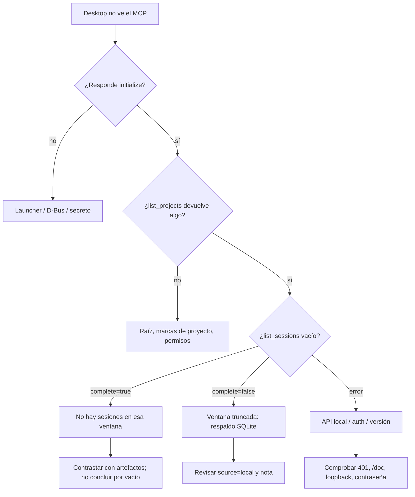

# Runbook: diagnóstico de MCP local y ChatGPT Desktop

Procedimiento operativo para la integración de observación entre ChatGPT
Desktop/Codex CLI y OpenCode. Complementa la arquitectura canónica en
[`../architecture.md`](../architecture.md) §3–§4 y el runbook de la fase 2
[`chatgpt-opencode-phase2.md`](chatgpt-opencode-phase2.md). No duplica el
diseño; solo ordena el diagnóstico.

## Alcance y límites

- **Solo lectura:** este runbook no inicia sesiones, no responde permisos, no
  escribe proyectos y no ejecuta agentes. `master-orchestrator` sigue siendo el
  orquestador en OpenCode.
- **Sin secretos en la evidencia:** no copiar contraseñas, tokens, cookies,
  contenido de llavero, prompts, argumentos, respuestas, rutas de clientes ni
  nombres de proyectos corporativos. Usar placeholders.
- **No hay observabilidad en vivo:** los eventos se leen bajo demanda desde
  `<proyecto>/.opencode/.foundry/events.jsonl`; no se consume `/event` ni un
  stream. La ausencia de un evento no prueba que una acción no ocurrió.
- **No hay ejecución remota:** si el problema requiere ejecutar algo, se
  resuelve en OpenCode con el rol autorizado, no desde Desktop.
- **Compatibilidad:** la referencia verificada es OpenCode 1.18.31. Otras
  versiones pueden cambiar el contrato; comprobar `/doc` antes de confiar.

## 1. Triage rápido



Regla general: **primero el transporte, después la autenticación, después el
alcance del proyecto y al final la interpretación de los datos.** No mezclar
capas: un `401` no es un problema de proyecto; una lista vacía no es un
problema de auth.

## 2. El MCP no arranca o no responde `initialize`

### 2.1 Comprobar el comando configurado

En **Settings → MCP servers → Add server** (STDIO) o en `config.toml`:

```text
command: python3
args: <foundry>/tooling/opencode_mcp_launch.py --projects-root <projects-root> --base-url http://127.0.0.1:4096
```

Equivalentes válidos:

- `<projects-root>` debe ser una ruta absoluta, existente y **no** symlink.
- `--base-url` debe ser `http://127.0.0.1:<puerto>` o una IP literal que el
  kernel enrute localmente por `lo`; no se aceptan HTTPS, credenciales en URL,
  rutas, query ni fragmentos.
- En Desktop, preferir el launcher. El servidor directo
  `<foundry>/tooling/opencode_mcp.py` solo es para desarrollo local con el
  entorno ya provisto.

### 2.2 Comprobar D-Bus y Secret Service

El launcher necesita el bus de sesión para consultar el llavero. El cliente
Desktop debe reenviar:

```text
DBUS_SESSION_BUS_ADDRESS
XDG_RUNTIME_DIR
```

No contienen la contraseña, pero sin ellas el launcher no puede hablar con
Secret Service. Síntoma típico: el proceso muere antes de `initialize` con
`Error: No se pudo obtener la credencial`.

Comprobaciones seguras (no imprimen el valor):

```bash
# ¿Existe la entrada de contraseña? Solo muestra presente/ausente.
if secret-tool lookup app agent-foundry-opencode field password >/dev/null 2>&1; then
  echo "credencial presente"
else
  echo "credencial ausente o llavero bloqueado"
fi

# ¿El proceso ve el bus de sesión?
printf '%s\n' "${DBUS_SESSION_BUS_ADDRESS:+D-Bus presente}" "${XDG_RUNTIME_DIR:+runtime presente}"
```

No ejecutar `secret-tool lookup` sin redirección en una terminal compartida ni
pegar el resultado en un informe. Si el llavero está bloqueado, desbloquearlo
desde la sesión gráfica; si falta `secret-tool`, instalarlo en el host del
cliente.

### 2.3 Comprobar la provisión del secreto

Una vez por host (el valor se pide por terminal):

```bash
secret-tool store --label='agent-foundry OpenCode username' app agent-foundry-opencode field username
secret-tool store --label='agent-foundry OpenCode password' app agent-foundry-opencode field password
```

- `username` es opcional; si no existe, el launcher usa `opencode`.
- `password` es obligatoria; sin ella no arranca.
- Para rotar, repetir `store`. Para revocar:
  `secret-tool clear app agent-foundry-opencode field password` (y `username`
  si aplica).
- No exportar los valores en shell, no pasarlos por argumentos/URL/config y no
  copiarlos a archivos del repositorio.

### 2.4 Comprobar el intérprete y el servidor

El launcher resuelve `--python` (por defecto el intérprete actual), exige que
sea un archivo absoluto y que `<foundry>/tooling/opencode_mcp.py` exista y no
sea symlink. Si falla:

- `Intérprete de Python no disponible` → ruta/entorno del cliente.
- `servidor MCP no disponible` → el checkout de Foundry no está completo.
- `raíz de proyectos inválida` → ruta relativa, symlink o inexistente.

No cambiar permisos del sistema para “arreglarlo”; corregir la ruta o el
entorno del cliente.

## 3. El MCP arranca pero la API local falla

### 3.1 `401` o acceso anónimo

La API local de OpenCode exige Basic auth si se configuró
`OPENCODE_SERVER_PASSWORD`. El acceso anónimo a `/global/health`, `/doc` o
`/session` devuelve `401`; eso **no** significa que el servidor esté caído.

Comprobar:

1. Que el servidor escuche en loopback (o ruta local por `lo`) y en el puerto
   esperado.
2. Que el proceso del MCP tenga `OPENCODE_SERVER_PASSWORD` (y, si aplica,
   `OPENCODE_SERVER_USERNAME`) en su entorno.
3. Que la contraseña sea la de la **API local**, no la de OpenCode Go ni la de
   ChatGPT/OpenAI. Son autenticaciones separadas.
4. Que no haya un proxy ni una redirección en medio: el puente las rechaza.

No pasar la contraseña en la URL ni en la línea de comandos. No desactivar la
auth para “probar”: la prueba dejaría de representar el entorno real.

### 3.2 Contrato de versión

Antes de usar información sensible:

- Verificar la versión en `/global/health` (con auth) y el contrato en `/doc`.
- En 1.18.31, `/doc` expone OpenAPI 3.1 con rutas de sesiones y mensajes.
- Si `/doc` o `/session` devuelven HTML (por ejemplo, un binario distinto o un
  lanzador que instaló otra versión), **no** usar ese servidor con el puente:
  el contrato no coincide.
- No asumir la API v2 (`/api/session`) ni parámetros no documentados.

### 3.3 `ProviderModelNotFoundError` o `/provider` incompleto

Si el puente conecta pero una ejecución de OpenCode falla por modelo:

- Revisar `/connect` y `/models` en OpenCode; el proveedor del binding debe
  estar conectado.
- No cambiar bindings de modelo ni credenciales desde este runbook. Un cambio
  de modelo sigue `model-change.md` y exige evals.
- Un fallo de generación no invalida la lectura de metadatos: son capas
  distintas.

## 4. `list_projects` vacío o incompleto

`list_projects` solo descubre **hijos directos reales** de `--projects-root`
que contengan:

- `.opencode/` (directorio, no symlink), o
- `install-manifest.yaml` (archivo, no symlink).

No lista:

- carpetas sin marca;
- rutas anidadas;
- enlaces simbólicos;
- nombres que no cumplen el patrón de segmento simple.

Comprobaciones:

```bash
# Sin revelar contenido: contar hijos directos y marcas.
find <projects-root> -mindepth 1 -maxdepth 1 -type d | wc -l
find <projects-root> -mindepth 1 -maxdepth 1 -type d \
  \( -exec test -d '{}/.opencode' \; -o -exec test -f '{}/install-manifest.yaml' \; \) -print
```

Si el proyecto está enlazado, anidado o no tiene marca, no aparecerá. Mover o
crear la marca es una decisión del proyecto, no un ajuste del MCP. No seguir
symlinks para “hacerlo aparecer”.

## 5. `list_sessions` vacío, truncado o con sesiones ajenas

### 5.1 Interpretar la respuesta

`list_sessions` devuelve:

```json
{
  "sessions": [{"id": "...", "parent_id": null, "created": 0, "updated": 0}],
  "complete": false,
  "source": "api",
  "note": "ventana parcial; puede haber más sesiones"
}
```

- `complete=true`: la ventana cubre lo consultado y el proyecto cabe en el
  límite.
- `complete=false`: ventana/historial parcial. **Un vacío con `complete=false`
  no es concluyente.**
- `source=api`: lectura de la API local.
- `source=local`: respaldo del historial SQLite.
- `note`: explica la parcialidad; no es un error de transporte.

### 5.2 Ventana de sesiones en OpenCode 1.18.31

En 1.18.31, `GET /session` se documenta como lista total sin parámetros. No hay
filtro `directory` ni paginación oficiales y no se asume la API v2. El puente:

- intenta `?limit=&offset=` solo con enteros, de forma defensiva;
- si el servidor repite la página o rechaza el parámetro, degrada a una sola
  lectura marcada como posiblemente truncada;
- filtra localmente por ruta real del proyecto (`same_project()`), sin
  symlinks;
- si la ventana es incompleta y vacía, usa el respaldo SQLite si está
  disponible.

Las sondas sin credencial a `/session`, `?directory=…` y `?limit=…&offset=…`
devuelven `401`: la auth precede al filtro, así que el soporte de parámetros no
se puede verificar sin secreto. No interpretar ese `401` como “el parámetro no
existe” ni como “la API está rota”.

### 5.3 Sesiones ajenas

Si aparecen sesiones de otro proyecto, es un fallo de aislamiento, no un dato
a interpretar. Comprobar:

1. Que la consulta use el `project` correcto (nombre simple, no ruta).
2. Que la raíz sea la esperada y no un symlink.
3. Que la sesión tenga `directory` absoluto, sin `..`, no symlink, y que su
   ruta real coincida exactamente con el proyecto.
4. Que no se esté usando una versión modificada del puente.

No “limpiar” el resultado a mano ni mezclar proyectos en un informe. Registrar
el caso con IDs redactados y escalar.

### 5.4 Respaldo SQLite

El respaldo se activa si la API falla o devuelve una ventana vacía incompleta.
Requisitos:

- Ruta explícita `--opencode-db` (servidor directo) o autodetección de
  `~/.local/share/opencode/opencode.db`.
- Archivo real, no symlink.
- Esquema con tabla `session` y columnas `id`, `directory`, `time_created`,
  `time_updated`; `parent_id` es opcional.
- Lectura estricta: `mode=ro` + `PRAGMA query_only=ON`; sin escritura ni
  bloqueo.
- Solo metadatos: nunca títulos, mensajes, partes ni contenido.

Si el esquema no coincide, el respaldo falla cerrado con error genérico. **No**
editar el `.db`, no crear tablas, no “reparar” el historial desde este runbook.

**Limitación del launcher:** reenvía `--projects-root` y `--base-url`, pero no
`--opencode-db`. Con launcher, el respaldo solo autodetecta la ruta por
defecto. Para una ruta explícita, usar el servidor directo con el entorno ya
provisto; no agregar el flag al launcher sin revisar el contrato.

## 6. `get_session_status`, eventos y mensajes

- **Estado `null`:** no hay estado publicado para esa sesión; no equivale a
  “idle”. Contrastar con la ventana de sesiones y los eventos.
- **Eventos vacíos:** el observer puede no estar instalado, haber fallado o no
  haber registrado ese tipo. La ausencia no prueba que no ocurrió una acción.
- **Mensajes:** solo metadatos (id, rol, agente, tiempos, nombres de
  herramientas). No hay prompts, argumentos, respuestas ni resultados.
- **Sesión ajena o sin directorio verificable:** el servidor rechaza la
  consulta con error genérico. No reintentar con otra ruta para “ver si
  aparece”.

Comandos locales de apoyo (sin contenido sensible):

```bash
# Resumen de eventos del proyecto (metadatos)
python3 <foundry>/tooling/observe.py --project <proyecto>

# Consulta directa de sesiones (sin launcher, entorno ya provisto)
python3 <foundry>/tooling/opencode_bridge.py \
  --projects-root <projects-root> --project <nombre> sessions --limit 100
```

## 7. Permission Guardian en simulación

La simulación clasifica una solicitud local:

```json
{"action": "read", "resources": ["<ruta-absoluta-dentro-del-proyecto>"]}
```

```bash
python3 <foundry>/tooling/opencode_bridge.py \
  --projects-root <projects-root> --project <nombre> \
  simulate --request <solicitud.json>
```

Interpretación:

- `read-candidate`: lectura interna candidata a revisión humana.
- `escalate-to-human`: acción con efectos, ruta externa o información
  insuficiente.
- Ambos mantienen `requires_real_approval: true` y `mode: simulation`.

La simulación **no** responde permisos, no modifica `profiles/permissions.yaml`
ni las reglas de OpenCode y no firma gates. El permiso real se concede en la UI
nativa de OpenCode. No pegar argumentos de herramientas ni secretos en el JSON.

## 8. El cliente Desktop conecta pero no hay datos

Orden de comprobación:

1. `list_projects` devuelve el proyecto esperado.
2. `list_sessions` con ese `project` devuelve una sesión; si está vacío,
   revisar `complete`/`source` antes de concluir.
3. `get_session_status` con un `session_id` devuelto.
4. `get_session_events` con el mismo `project` y `session_id`.
5. Contrastar con el recibo de instalación, la versión del bundle y los
   artefactos del incremento.

Una lista vacía por sí sola **no** demuestra conexión autenticada ni ausencia de
actividad. Un `200` con `complete=false` es una ventana parcial, no una
respuesta completa.

## 9. Evidencia para escalar

Recoger, redactando:

- versión de OpenCode y resultado de `/global/health` (sin credenciales);
- si `/doc` devuelve JSON/OpenAPI o HTML;
- mensaje de error **genérico** del launcher/MCP;
- si el proceso tenía `DBUS_SESSION_BUS_ADDRESS`/`XDG_RUNTIME_DIR` (sí/no, sin
  valores);
- si `secret-tool` existe y si la entrada está presente (sí/no, sin valor);
- raíz de proyectos (sin nombres de clientes), tipo de marca y si hay symlinks;
- `list_sessions` con `complete`, `source` y `note` (IDs redactados);
- qué se observó y qué se infirió.

No adjuntar `events.jsonl` crudo, `.db`, capturas con datos, prompts,
argumentos ni respuestas. Si hace falta, adjuntar un resumen redactado o
hashes.

## 10. Escalamiento

| Síntoma | Siguiente paso | No hacer |
|---|---|---|
| Launcher no arranca | Revisar D-Bus, llavero y rutas; escalar al responsable del host. | Desactivar auth, pasar secreto por argumentos. |
| `401` persistente | Verificar contraseña/usuario de la API local y versión. | Probar credenciales de OpenCode Go/ChatGPT. |
| `/doc` HTML o contrato distinto | Cambiar a la versión compatible (1.18.31 verificada) y revisar `/doc`. | Asumir que el puente “debería” funcionar. |
| `list_projects` vacío | Revisar raíz, marcas y symlinks. | Mover proyectos o seguir enlaces sin decisión. |
| `list_sessions` vacío+incompleto | Revisar respaldo SQLite y `note`. | Concluir “no hay actividad”. |
| Sesiones ajenas | Fallo de aislamiento: registrar y escalar. | Mezclar datos o “filtrar a mano”. |
| Eventos ausentes | Revisar instalación del observer y el recibo. | Afirmar que no se ejecutó. |
| Permiso dudoso | Escalar al humano; simulación solo orienta. | Responder el permiso desde Desktop. |

## 11. Referencias

- Arquitectura: [`../architecture.md`](../architecture.md) §3–§4.
- Fase 1: [`chatgpt-opencode-phase1.md`](chatgpt-opencode-phase1.md).
- Fase 1.5 (histórico): [`chatgpt-opencode-phase15-results.md`](chatgpt-opencode-phase15-results.md).
- Fase 2: [`chatgpt-opencode-phase2.md`](chatgpt-opencode-phase2.md).
- Observer y Permission Guardian: [`agent-operations.md`](agent-operations.md).
- Skills desktop: [`chatgpt-desktop-skills.md`](chatgpt-desktop-skills.md).
- ADRs: [`../adr/0001-master-orchestrator-sigue-orquestando.md`](../adr/0001-master-orchestrator-sigue-orquestando.md),
  [`../adr/0002-mcp-local-lectura-sin-escritura.md`](../adr/0002-mcp-local-lectura-sin-escritura.md).
